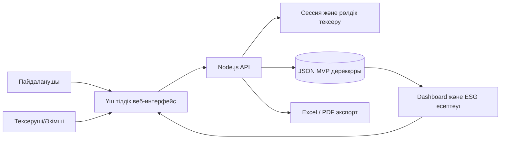
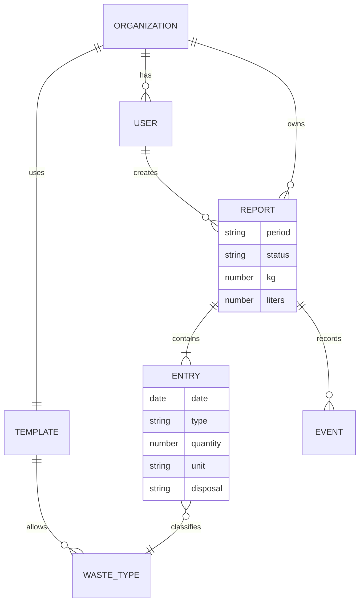

# EcoFood ATU: архитектура және процесс

## Қазіргі және мақсатты процесс

| Қадам | Қазіргі қолмен процесс | EcoFood ATU процесі |
|---|---|---|
| Жинау | Қағаз/кесте, әр ұйым бөлек | Ұйым шаблоны, QR және мобильді енгізу |
| Есеп | Бірнеше файл, қолмен қосу | Бір айлық есепте бірнеше өлшеу, автоматты кг/л қорытындысы |
| Тексеру | Мессенджер/пошта арқылы | Статус, пікір, қайтару және тарих |
| Жиынтық | Көшіріп жинау | Қабылданған есептердің бірыңғай тізілімі |
| Талдау | Кешіктірілген қолмен есеп | Динамика, тоқсан, ұйым, ESG және экспорт |

## Қолданба архитектурасы

GitHub Pages-та API орнына браузерлік демо-қабат қолданылады. Ол презентациялық тексеруге арналған және көп пайдаланушылы өндірістік сақтау болып саналмайды.

## Негізгі деректер моделі

## Енгізу кезеңдері

1. Пилот: бес ұйым, үш айлық демо деректер, жауапты адамдарды оқыту.
2. Тексеру: ATU бекіткен қалдық жіктемесі, CO₂e коэффициенттері және есеп мерзімдері.
3. Өндіріс: SSO, PostgreSQL, фотоға объектілік сақтау, резервтік көшіру және мониторинг.
4. Масштабтау: барлық корпус, автоматты хабарламалар және басқарушылық ESG есебі.

Негізгі тәуекелдер: бастапқы дерек сапасы, өлшеу тәртібі, интернет/камера рұқсаты және ESG коэффициенттерінің бекітілмеуі. Оларды міндетті валидация, QR-дің қолмен енгізу баламасы, аудит тарихы және әдістемені ашық көрсету арқылы азайтамыз.
